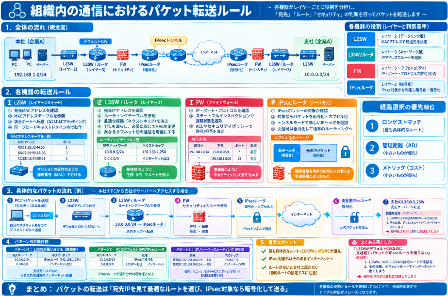

社内LANや拠点間通信、あるいは出張先から社内ネットワークに接続など、組織での通信にはいろんなタイプが存在します。
パケットがどのようなルールに基づいて転送されることになるか知っておくと、いざ、通信するときやトラブルがあった場合の対処に役立つことになります。

本日はそんな組織内の通信、パケットの転送ルールについて説明していきます。

## パケット転送ルール
パケットが複数のネットワーク機器を通過する際の転送ルールについて、順を追って説明いたします。

### コアアイデア

パケットの転送は、**「レイヤーごとの役割分担」** と **「経路選択の優先順位」** によって決まります。各機器は自分の担当する階層（OSI参照モデルのレイヤー）で判断を行い、次に送る先を決定します。

### 直感的な理解

郵便物の配送に例えると理解しやすいです。

- **L2SW（レイヤー2スイッチ）**は、マンションの受付のようなものです。部屋番号（MACアドレス）を見て、同じ建物内のどの部屋へ届けるかを判断します。
- **L3SW（レイヤー3スイッチ）/ルータ**は、郵便局のようなものです。住所（IPアドレス）を見て、別の建物・別の町へ送る必要があるかどうかを判断します。
- **FW（ファイアウォール）**は、警備員のようなものです。届いた郵便物の中身や送り状を確認し、「危険なもの」や「許可されていないもの」を通さずに破棄します。
- **IPsecルータ**は、機密書類を送る専用の封筒に入れ替える郵便局員のようなものです。中身を暗号化してから次の宛先へ送ります。

### 各機器の具体的な転送ルール

__1. L2SW（レイヤー2スイッチ）の動作__

L2SWは**データリンク層（レイヤー2）** で動作し、**MACアドレス**に基づいて転送します。

- 受信したフレームの「宛先MACアドレス」を確認します
- MACアドレステーブル（CAMテーブル）を参照し、そのMACアドレスが接続されているポートを特定します
- 該当するポートからのみフレームを送信します（ユニキャストの場合）
- MACアドレステーブルに該当がない場合、受信ポート以外の全ポートにフラッディングします
- 同一ブロードキャストドメイン内でのみ動作します

__2. L3SW / ルータの動作__

L3SWやルータは**ネットワーク層（レイヤー3）** で動作し、**IPアドレス**に基づいて転送します。

- 受信したパケットの「宛先IPアドレス」を確認します
- ルーティングテーブルを参照し、最も適切な経路（ネクストホップや出力インターフェース）を決定します
- パケットのTTL（Time To Live）を1減らします
- 必要に応じて、宛先MACアドレスを書き換えます（L2ヘッダーの再作成）
- 異なるサブネット間の通信を可能にします

**経路選択の優先順位**：
- 最も具体的な（ロンゲストマッチ）ルートが優先されます
- 同じ宛先ネットワークが複数ある場合は、管理距離（AD）が小さいものが優先
- さらに同じ場合は、メトリック（コスト）が小さいものが優先

__3. FW（ファイアウォール）の動作__

FWは**レイヤー3〜レイヤー7**で動作し、**セキュリティポリシー**に基づいて転送を制御します。

- パケットの送信元・宛先IPアドレス、ポート番号、プロトコルなどを確認します
- ステートフルインスペクション（状態管理）を行う場合が多く、接続の状態を追跡します
- 設定されたACL（アクセスコントロールリスト）やゾーンベースポリシーに従い、許可（forward）または拒否（drop/reject）を決定します
- 許可されたパケットのみが転送されます

__4. IPsecルータの動作__

IPsecルータは、**暗号化と認証**を行うルータです。

- パケットがIPsecポリシーの対象かどうかを確認します
- 対象の場合、パケットを暗号化（ESP）または認証（AH）してカプセル化します
- トンネルモードの場合、新しいIPヘッダーが追加されます
- 通常のルーティングと同様に、カプセル化後のパケットを転送します
- 受信時は、暗号化を解除してから通常のルーティング処理を行います

### パケットが複数機器を通過する際の流れ

例えば、社内LANのPCからIPsecトンネルを経由して支社のサーバーへアクセスする場合：

1. PCがパケットを送信（宛先IP = 支社サーバー）
2. **L2SW**：MACアドレスに基づいて、デフォルトゲートウェイ（L3SWまたはルータ）へ転送
3. **L3SW/ルータ**：ルーティングテーブルを参照し、次のホップ（FWまたはIPsecルータ）へ向けて転送
4. **FW**：セキュリティポリシーを確認し、許可されたパケットのみ転送
5. **IPsecルータ**：IPsecポリシーに従いパケットを暗号化・カプセル化し、インターネット経由で支社へ送信
6. 支社側のIPsecルータで復号化
7. 支社側のL3SW/L2SWが宛先サーバーへパケットを届ける

### よく混同されるポイント

| 誤解 | 正しい理解 |
|------|-----------|
| L3SWはL2SWの機能を持たない | L3SWは基本的にL2SWの機能も兼ね備えています |
| FWはルータと同じ | FWはフィルタリングが主目的で、ルーティングは副次的な場合が多いです |
| IPsecは暗号化だけ | 認証・完全性確認も重要な機能です |
| ルーティングは常に最短経路 | 実際にはポリシールーティングやコスト、管理距離などで優先順位が変わります |

## ケーススタディ

**「パケットの宛先IPアドレス（どこへ行くか）」と「ルーティングテーブル・IPsecポリシーの照合順序」** によって、同じ送信元から出たパケットでも通る道が変わります。
実際のケースに沿ってどのようにパケット転送されることになるか確認していきます。

### 具体的なシナリオで考えてみましょう

以下のようなネットワーク構成を想定します：

```
[PC] → [L3SW（デフォルトGW）] → [IPsecルータ] → Internet
                              ↓
                        [インターネット出口（通常ルート）]
```

- 社内ネットワーク：`192.168.1.0/24`
- 支社ネットワーク（IPsec対向）：`10.0.0.0/24`
- L3SWのデフォルトルート：`0.0.0.0/0` → インターネット出口ルータ
- IPsecルータのLAN側IP：`192.168.1.254`

### パターン1：L3SWが「宛先に応じて振り分ける」場合

L3SW上で以下のように設定されているとします：

| 宛先ネットワーク | ネクストホップ |
|----------------|--------------|
| `10.0.0.0/24`（支社） | `192.168.1.254`（IPsecルータ） |
| `0.0.0.0/0`（その他） | インターネット出口ルータ |

この場合の転送ルールは：

__パケットA：宛先 = `10.0.0.50`（支社サーバー）__
1. PCがパケットを送信（宛先IP = `10.0.0.50`）
2. PCは「自分のサブネット外」と判断し、**デフォルトGW（L3SW）へ送信**
3. L3SWはルーティングテーブルを参照
4. `10.0.0.0/24` の静的ルートにマッチ → **IPsecルータ（`192.168.1.254`）へ転送**
5. IPsecルータは「興味深いトラフィック（Interesting Traffic）」と判断し、**IPsecトンネル経由で暗号化して送信**

__パケットB：宛先 = `8.8.8.8`（Google DNSなどインターネット）__
1. PCがパケットを送信（宛先IP = `8.8.8.8`）
2. PCはデフォルトGW（L3SW）へ送信
3. L3SWはルーティングテーブルを参照
4. `8.8.8.8` は `10.0.0.0/24` にマッチしない
5. デフォルトルート（`0.0.0.0/0`）にマッチ → **インターネット出口へそのまま転送**
6. IPsecルータは**通過させません**

### パターン2：PCのデフォルトGWがIPsecルータになっている場合

```
[PC] → [IPsecルータ（デフォルトGW）] → [L3SW] → Internet
```

この場合、IPsecルータが「振り分けの司令塔」になります。

| 宛先ネットワーク | 処理 |
|----------------|------|
| `10.0.0.0/24`（支社） | IPsecカプセル化して送信 |
| `0.0.0.0/0`（その他） | L3SW → インターネット出口へ転送 |

- 支社宛てのパケットはIPsecルータで暗号化され、インターネットへ
- その他はIPsecルータからL3SWへ渡され、通常のインターネット通信として送出

### パターン3：ポリシーベースルーティング（PBR）を使う場合

L3SWが高機能な場合、**「宛先IPだけでなく、送信元やポート番号、プロトコル」** によって次のホップを変えることができます。

例えば：
- 経理部（`192.168.10.0/24`）から支社へ → IPsecルータ経由
- 開発部（`192.168.20.0/24`）から支社へ → 通常のインターネットVPN経由（IPsecしない）

このように、**「誰が」「どこへ」「どのサービスで」アクセスするか**で転送先を変えることができます。

### 重要なルールまとめ

| 判断の基準 | どの機器が判断するか |
|-----------|------------------|
| 宛先IPアドレスがIPsec対象ネットワークか | L3SW（ルーティングテーブル）またはIPsecルータ |
| パケットを暗号化するかどうか | IPsecルータ（Interesting Trafficの照合） |
| インターネットへ出すかどうか | デフォルトルートを持つ機器（L3SWやIPsecルータ） |

### よくある落とし穴

**「L3SWがデフォルトGWなのに、支社宛てパケットがIPsecルータを通らない」**

原因として考えられるのは：
1. L3SWに `10.0.0.0/24` への静的ルートが設定されていない
2. 結果として、デフォルトルートに従いインターネット出口へ出てしまい、暗号化されずに支社へ到達できない

## 総括

パケットの通信ルールは、宛先IPを見て、最も具体的なルートを選び、IPsec対象なら暗号化して送るです。

### もう少し分解すると

| 機器 | 何を見るか | 何を決めるか |
|------|-----------|------------|
| L2SW | MACアドレス | 同じ建物（セグメント）内のどこへ届けるか |
| L3SW | 宛先IPアドレス | どの道（ネクストホップ）へ送るか |
| FW | IP・ポート・プロトコル | 通すか、破棄するか |
| IPsecルータ | 宛先IPが対象ネットワークか | 暗号化して送るか、そのまま送るか |

### 覚えておくべき3つのルール

1. **ロンゲストマッチ**：最も具体的な（prefixが長い）ルートが優先される
2. **IPsec対象外はそのまま**：暗号化しないパケットは通常のインターネット経由で送られる
3. **ルートがないと届かない**：L3SWに静的ルートがないと、支社宛てパケットがIPsecルータを通らずにインターネットへ出てしまう


