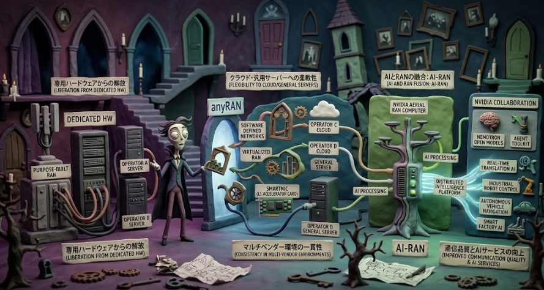

ネットワーク構築は柔軟性を向上させるエッジコンピューティングや分散化が行われています。
そんな流れの中で無線アクセスネットワーク(RAN)をソフトウェアで制御を行い柔軟性を向上させようという構想があります。

今日はそんな構想であるanyRANについて説明していきます。
因みにこの流れの中でNvidiaもコラボしています。

## anyRAN

anyRANが実現しようとしていることは、一言で言えば「**無線アクセスネットワーク（RAN）を、専用ハードウェアに縛られない柔軟なソフトウェア定義のネットワークへ変革する**」ことです。

具体的には、以下の4つのことを実現します。

### 1. どんなサーバー・クラウドでもRANが動くようにする

従来の基地局（RAN）は、Nokiaや各ベンダーが提供する専用のハードウェア（purpose-built RAN）上で動作していました。これは性能は高いものの、ベンダーに依存しやすく、柔軟性に欠けていました。

anyRANはこの常識を覆し、**NokiaのRANソフトウェアを「どのベンダーのサーバー」「どのクラウドプラットフォーム」上でも動作させられる**ようにしました。例えばDell、HPE、Red Hatなどのパートナー企業のインフラ上でNokiaのRANソフトウェアが動作します。[Nokia anyRAN](https://www.nokia.com/mobile-networks/ran/anyran/)

これにより、通信事業者は「Nokiaのソフトウェアは使いたいが、サーバーは自社で選びたい」という要望を実現できます。

### 2. 専用RANとCloud RANを混在させる「ハイブリッドRAN」の実現

通信事業者が抱える大きな課題の一つは、既存の専用基地局（purpose-built RAN）を全て一度にクラウド化するのは現実的でない、という点です。

anyRANは、**従来の専用RANと新しいCloud RANを同じネットワーク内で混在させる**ことを可能にします。これを「ハイブリッドRAN」と呼びます。事業者は自社のペースで、一部の基地局から順番にCloud RANへ移行することができます。[Nokia anyRAN](https://www.nokia.com/mobile-networks/ran/anyran/)

### 3. マルチベンダー環境でも性能と機能の一貫性を保つ

Open RANやCloud RANの課題の一つは、「別のベンダーのハードウェアに乗せ替えると性能が落ちる」ことです。

anyRANは、NokiaのCloud RAN SmartNIC（Layer 1加速カード）を活用することで、**専用ハードウェア上のRANと、汎用サーバー上のCloud RANで性能の差をほぼなくす**ことを実現しました。これにより、通信事業者はインフラを選びながらも、ユーザーに提供する通信品質を一定に保てます。[Nokia MWC23 Press Release](https://www.nokia.com/newsroom/nokia-launches-anyran-to-drive-cloudran-partnerships-enabling-flexibility-for-mobile-network-operators-and-enterprises-mwc23/)

## 開発背景

anyRANが開発された背景には、従来の無線アクセスネットワーク（RAN）が抱えていた構造的な課題がいくつかあります。以下に主な課題を整理してご説明します。

### 1. 専用ハードウェアへの過度な依存（ベンダーロックイン）

従来の基地局（purpose-built RAN）は、特定のベンダー（Nokia、Ericsson、Huaweiなど）が提供する専用のハードウェアとソフトウェアが一体化した形で提供されていました。

これにより以下の問題が生じていました：

- **サプライヤー選択の不自由さ**: 一度あるベンダーの設備を導入すると、ソフトウェアもハードウェアも同じベンダーから購入し続ける必要があり、価格交渉や技術選定の自由度が大きく制限されました。
- **投資の硬直化**: 新しい技術を導入したい場合でも、既存の専用ハードウェアを置き換える必要があり、巨額の投資と長期間の計画が求められました。

anyRANはこの「ベンダーロックイン」を解消し、**ソフトウェアとハードウェアを分離して、事業者が自由に組み合わせを選べる**ようにすることを目指しました。[Nokia anyRAN](https://www.nokia.com/mobile-networks/ran/anyran/)

### 2. Cloud RAN移行時の「性能と機能の不一致」

通信業界全体でCloud RAN（クラウド化された基地局）への移行が進められていますが、ここには大きな障壁がありました。

- **性能の低下リスク**: 専用ハードウェア上で動作していたRAN機能を、汎用サーバー上のソフトウェアに移すと、処理能力が落ちる可能性がありました。特にLayer 1（物理層）の処理は計算量が膨大で、汎用CPUだけでは従来の専用機器と同等の性能を出すのが難しい状況でした。
- **機能の不一致**: 専用RANとCloud RANで提供できる機能が異なると、事業者はユーザーに一貫したサービスを提供できません。

Nokiaはこの課題に対し、**Cloud RAN SmartNIC（Layer 1加速カード）** を開発し、anyRANを通じて「どのインフラ上でも専用機器と同等の性能を保証」することで、事業者が安心してCloud RANへ移行できる道を開きました。[Nokia MWC23 Press Release](https://www.nokia.com/newsroom/nokia-launches-anyran-to-drive-cloudran-partnerships-enabling-flexibility-for-mobile-network-operators-and-enterprises-mwc23/)

### 3. 既存設備を「全て捨てる」しかない移行プレッシャー

通信事業者が抱えるもう一つの深刻な課題は、既存の専用基地局（purpose-built RAN）への巨額な投資です。

- 専用RANからCloud RANへ移行する際、「全部を一度に置き換えなければならない」とすれば、膨大なコストと時間がかかります。
- しかし、一部だけをCloud RANにして他を専用RANのままにすると、ネットワーク全体で機能や性能に差が生じ、運用が複雑化するリスクがありました。

anyRANはこの課題に対し、**専用RANとCloud RANを混在させる「ハイブリッドRAN」を、性能と機能の一貫性を保ったまま実現**することで、事業者が「自社のペースで段階的に移行できる」環境を提供しました。[Nokia anyRAN](https://www.nokia.com/mobile-networks/ran/anyran/)

### 4. 通信インフラとAIインフラの「分断」による非効率

5G時代に入り、通信ネットワークは単なる「通話・データ通信」の基盤ではなく、産業用ロボット、自動運転、スマートファクトリーなどを支える重要インフラとなりました。これらにはAI処理が不可欠です。

しかし従来は：

- **通信設備（RAN）** と**AI計算基盤（データセンター/エッジサーバー）** が別々に構築・運用されており、設備投資や電力消費の二重化が起きていました。
- 基地局は「通信だけ」を処理し、AIは遠方のクラウドで処理されるため、遅延（レイテンシ）が大きく、リアルタイム性が要求される用途に対応しにくい状況でした。

anyRANとNvidia Aerial RAN Computerの統合（AI-RAN）は、**同一のサーバーで通信処理とAI処理を同時に実行**することで、この非効率を解消し、基地局そのものを「AIが動くエッジコンピュータ」へと進化させることを目指しています。[NVIDIA Newsroom](https://nvidianews.nvidia.com/news/nvidia-nokia-and-leading-telecom-operators-turn-networks-into-distributed-intelligence-platforms)

### 5. スペクトル（周波数）資源の限界

モバイル通信の需要は爆発的に増加していますが、使える電波（スペクトル）は有限です。

- 従来のRANでは、電波の利用効率（スペクトル効率）の改善にはハードウェア的な進化が中心で、ソフトウェアによる最適化には限界がありました。
- 新しい周波数帯を取得するには各国で高額な競売に参加する必要があり、事業者にとって大きな負担となっていました。

anyRANのAI-RAN化は、**AIがリアルタイムで電波状況を分析し、最適な送信方法を自動調整**することで、既存の周波数資産からこれまで以上の容量を引き出すことを目指しています。Nokiaは2028年までにスペクトル効率を100%以上向上させることを目標としています。[Nokia AI-RAN Platform](https://www.nokia.com/newsroom/nokia-defines-the-next-era-of-radio-with-the-industrys-first-ai-native-ran-platform/)

### 6. ネットワーク運用の複雑化と人件費

5Gの進化に伴い、ネットワークはますます複雑になり、基地局の数も増大しています。

- 多様な設備（専用RAN、Cloud RAN、Open RAN）が混在すると、運用・管理・障害対応の負荷が増大します。
- 熟練した技術者が各現場に必要となり、運用コストが圧迫されていました。

anyRANの枠組みにNvidiaのAIモデルとAgent Toolkitが統合されることで、**AIエージェントが障害の検知・診断・修復を自律的に行う**仕組みが構築されつつあり、運用の自動化と効率化が進められています。[NVIDIA Newsroom](https://nvidianews.nvidia.com/news/nvidia-nokia-and-leading-telecom-operators-turn-networks-into-distributed-intelligence-platforms)

## anyRANとNvidia

anyRANはNokiaが開発したRAN（無線アクセスネットワーク）のソフトウェア・アプローチですが、このanyRANの枠組みの中でNvidiaも関与しています。

### 1. GPU加速コンピューティングプラットフォーム「Aerial RAN Computer（ARC）」の提供

Nokiaが2023年2月に発表したanyRANは、パートナー企業のクラウドや汎用サーバー上でもNokiaのRANソフトウェアを実行できるアプローチです。このanyRANエコシステムの中で、Nvidiaは**Aerial RAN Computer（ARC）**というGPU加速コンピューティングプラットフォームを提供しました。これにより、NokiaのanyRANソフトウェアはNvidiaのGPU上で高速に動作するようになりました。[Nokia anyRAN](https://www.nokia.com/mobile-networks/ran/anyran/)

### 2. AI-RAN（AIとRANの融合）の実現

anyRANの進化形として、NokiaとNvidiaはAI-RAN（AIと無線アクセスネットワークの融合）を共同で推進しています。NokiaのAI-native anyRANソフトウェアは、**NvidiaのAerial AI-RANプラットフォーム**上に構築されており、これにより2028年までにスペクトル効率が100%以上向上し、既存のスペクトル資産の容量が2倍になる見込みが示されています。[Nokia AI-RAN Platform](https://www.nokia.com/newsroom/nokia-defines-the-next-era-of-radio-with-the-industrys-first-ai-native-ran-platform/)

### 3. CUDA加速によるanyRANソフトウェアの商用化

Nvidiaは、NokiaのanyRANソフトウェアを**NVIDIA CUDAで加速**させる技術を提供しました。2026年10月の発表では、NokiaのCUDA加速anyRANソフトウェアがNvidia Aerial RAN Computer上で動作し、BT・Deutsche Telekom・Elisa・Orangeなどの通信事業者による現場での試験が行われていることが明らかになっています。[NVIDIA Newsroom](https://nvidianews.nvidia.com/news/nvidia-nokia-and-leading-telecom-operators-turn-networks-into-distributed-intelligence-platforms)

### 4. グローバル通信事業者との共同AI-RAN試験

anyRANの枠組みを活用し、Nvidiaは通信事業者とのAI-RAN試験を主導的な役割で支えています。具体的には：

- **T-Mobile**: 世界初のAI-RAN商用ネットワーク通話をNokiaおよびNvidiaと共同で達成
- **Elisa**: 欧州初のAI-RAN現場試験を、Nokia anyRANソフトウェアとNvidia ARCを用いて実施
- **Deutsche Telekom**: AI強化アップリンクチャネル推定の検証を、NokiaおよびNvidiaの商用AI-RANプラットフォームで実施
- **BT・Orange**: Nokia 5GソフトウェアをNvidia ARC上でテストし、AI-RANのスペクトル効率向上とエッジサービスを検証

全世界で約20の通信事業者が、Nokia anyRANソフトウェアとNvidia ARCを組み合わせたAI-RAN協業を公表しています。[NVIDIA Newsroom](https://nvidianews.nvidia.com/news/nvidia-nokia-and-leading-telecom-operators-turn-networks-into-distributed-intelligence-platforms)

### 5. AIモデルとエージェントツールによる自律ネットワーク運用の支援

anyRANの枠組みを超えて、Nvidiaは通信ネットワークの自律運用（Autonomous Network Operations）にも貢献しています。Nvidiaは**Nematronオープンモデル**と**Agent Toolkitソフトウェア**を提供し、NokiaがこれをAutonomous Networks Suiteに統合して、固定網・無線網・コア網・輸送網全体を管理する信頼性の高いエージェントを構築できるようにしました。[NVIDIA Newsroom](https://nvidianews.nvidia.com/news/nvidia-nokia-and-leading-telecom-operators-turn-networks-into-distributed-intelligence-platforms)

## 何が実現される？

anyRANの構想が実現することで、通信事業者だけでなく、私たちの生活や産業全体にも大きな変化がもたらされます。以下に、具体的に何が実現されるかを整理してご説明します。

### 1. 通信事業者が「通信インフラをAIコンピューティング基盤」に変えられる

これまで基地局は「電波を飛ばすための設備」でしたが、anyRANとNvidia Aerial RAN Computerの組み合わせにより、**基地局そのものがAIを処理するエッジコンピューティングノードへと進化**します。

つまり、通信事業者はこれまでの「通信回線を売るビジネス」から、「AI処理能力を提供するビジネス」へと転換できます。例えば、工場のロボット制御AIや音声認識AIを、基地局のサーバー上で実行できるようになります。[NVIDIA Newsroom](https://nvidianews.nvidia.com/news/nvidia-nokia-and-leading-telecom-operators-turn-networks-into-distributed-intelligence-platforms)

### 2. 通信とAIが「同じ機器」で動くことで、インフラ投資の効率化が実現する

従来は「通信設備」と「AI計算機（データセンター）」を別々に構築・運用する必要がありました。anyRANのAI-RAN構想では、**1台のサーバーで5G通信とAIワークロードを同時に処理**できます。

これにより、通信事業者は設備投資を抑えながら、通信品質の向上と新しいAIサービスの提供を両立できます。Nvidiaの技術ブログでは、この統合プラットフォームによりインフラ利用率が2〜3倍向上すると説明されています。[NVIDIA Technical Blog](https://developer.nvidia.com/blog/bringing-ai-ran-to-a-telco-near-you)

### 3. スペクトル（周波数）の利用効率が飛躍的に向上する

anyRANのAI-RAN化により、AIがリアルタイムで電波の状況を分析し、最適な送信方法を自動で調整できるようになります。Nokiaは、2028年までに**スペクトル効率が100%以上向上し、既存の周波数資産の通信容量が2倍になる**と見込んでいます。[Nokia AI-RAN Platform](https://www.nokia.com/newsroom/nokia-defines-the-next-era-of-radio-with-the-industrys-first-ai-native-ran-platform/)

これは、新しい周波数帯を取得せずに、既存のインフラでより多くのデータを送受信できることを意味します。結果として、混雑時の通信速度低下が減り、より多くのデバイスを同時に接続できるようになります。

### 4. 企業や公共機関向けの「超低遅延AIサービス」が身近になる

基地局にAI処理能力が搭載されることで、データを遠くのデータセンターに送らずに、**基地局のすぐそばでAI処理ができる**ようになります。

具体的な活用例としては以下が挙げられています：

- **Orange**: 救急隊員や現場作業員が複数言語をリアルタイムで翻訳できる音声インテリジェンスサービス
- **Deutsche Telekom**: ロボットの制御と調整を基地局エッジで行う産業用AI
- **Elisa**: 音声通話・モバイルデータ・ビデオ解析AIを同一プラットフォームで同時運用する企業アシスタント

これらは、遠方のデータセンターに依存しないため、遅延（レイテンシ）が極めて短く、信頼性が高いサービスとして提供できます。[NVIDIA Newsroom](https://nvidianews.nvidia.com/news/nvidia-nokia-and-leading-telecom-operators-turn-networks-into-distributed-intelligence-platforms)

### 5. 通信ネットワークの運用が「自律化」する

anyRANの枠組みにNvidiaのAIモデル（Nemotron）とAgent Toolkitが統合されることで、**ネットワークの障害検知・診断・自動修復をAIエージェントが行う**ようになります。

例えば、BTは基地局の設置写真をAIエージェントに検査させ、問題を自動で検出し、再訪問を減らす取り組みを進めています。これにより、通信事業者の運用コストが削減され、サービスの安定性が向上します。[NVIDIA Newsroom](https://nvidianews.nvidia.com/news/nvidia-nokia-and-leading-telecom-operators-turn-networks-into-distributed-intelligence-platforms)

### 6. 国や企業による「技術的な縛り」から解放される

anyRANは、RANの垂直層（ソフトウェアとハードウェア）および水平層（異なるベンダー間）で複数のサプライヤーを選択できるようにします。これにより、通信事業者は**特定のベンダーに依存せず、自国の事情やコストに合わせて最適な構成を自由に選べる**ようになります。[Nokia anyRAN](https://www.nokia.com/mobile-networks/ran/anyran/)

## 総括

anyRANがもたらす将来は、**「基地局が単なる通信設備から、AIも動かす汎用コンピュータへと変わる」** ことです。

具体的には以下の3点に集約されます。

1. **インフラの自由化**: 専用ハードウェアに縛られず、事業者が自らのペースでクラウド化を進められる柔軟なネットワークが実現します。
2. **通信とAIの融合**: 基地局がエッジAIコンピュータとなり、5G通信とロボット制御やリアルタイム翻訳などのAI処理を同一機器で同時に実行できるようになります。
3. **自律・高效化**: AIが電波を最適化して容量を倍増させ、ネットワークの障害検知・修復も自律的に行われるため、通信はより速く、安く、安定したサービスへと進化します。

つまり、**通信網そのものが社会の「分散型AI脳」へと進化する**将来がもたらされます。

